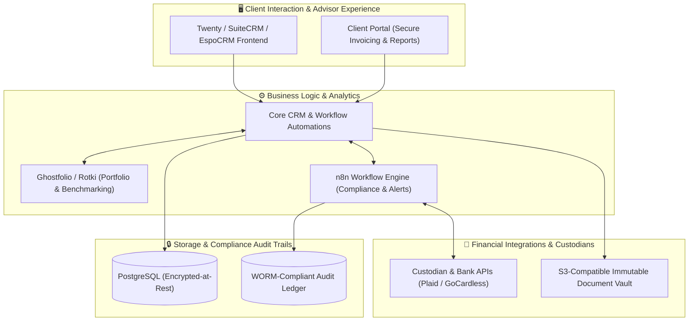

  

  
  
  
  
  
  

---

# 🏦 Awesome Financial Services CRM

> **A curated directory of premier SaaS platforms and production-ready open-source CRM software engineered for Wealth Management, Registered Investment Advisors (RIAs), Private Banking, Broker-Dealers, and Compliance Workflows.**

**Last updated:** March 2026

Customer Relationship Management (CRM) in financial services demands far more than basic sales pipelines. Financial institutions require intricate **household & multi-entity relationship mapping**, **custodian clearing integrations** (Charles Schwab, Fidelity, BNY Mellon Pershing), **strict regulatory audit trails** (SEC, FINRA, SOX, GLBA, GDPR), and **automated compliance reporting**. 

This repository tracks the leading **enterprise SaaS platforms** (ranked by company size and featuring verified starting prices and trial terms) alongside actively maintained **open-source CRM and financial management systems** (ranked by GitHub stars).

---

## 📑 Table of Contents

- [📊 Sector Overview & Market Dynamics](#-sector-overview--market-dynamics)
- [💼 SaaS / Hosted Enterprise Platforms](#-saas--hosted-enterprise-platforms)
- [🌐 Open-Source GitHub Projects](#-open-source-github-projects)
- [🏗️ Recommended Architecture for Custom Self-Hosted CRMs](#️-recommended-architecture-for-custom-self-hosted-crms)
- [🔍 Key Evaluation Criteria for Financial CRMs](#-key-evaluation-criteria-for-financial-crms)
- [🤝 How to Contribute](#-how-to-contribute)
- [⚖️ Disclaimer & Compliance Notice](#️-disclaimer--compliance-notice)

---

## 📊 Sector Overview & Market Dynamics

The global **Financial Services Customer Relationship Management (CRM) market** is valued at approximately **$13.8 Billion in 2025** and is projected to expand to **$28.4 Billion by 2032**, demonstrating a compound annual growth rate (**CAGR**) of **10.9%**.

Unlike generic horizontal CRM software where a small handful of generalist platforms dominate, the financial services CRM sector is **moderately-to-highly fragmented**. While enterprise titans like **Salesforce** (Agentforce Financial Services) and **Microsoft Dynamics** anchor tier-1 global retail banks, institutional broker-dealers, and cross-border commercial lenders, specialized vertical solutions (**Redtail**, **Wealthbox**, **Practifi**, and **Envestnet Tamarac**) capture substantial market share among independent Registered Investment Advisors (RIAs), boutique wealth managers, and independent broker-dealer networks. This persistent fragmentation is driven by highly specialized custodian clearing integrations (Schwab, Fidelity Institutional, Pershing), granular household relationship hierarchies, and rigid SEC/FINRA supervisory and email/SMS retention mandates that generalist platforms cannot address out of the box.

---

## 💼 SaaS / Hosted Enterprise Platforms

The table below catalogs the leading commercial financial CRM software suites. **Sorted in descending order by Company Size (Valuation / Revenue).**

| 🏢 Platform | 📈 Company Size (Valuation / Revenue) | 💰 Starting Price | ⏳ Free Tier / Trial Limits | 🎯 Core Focus & Key Capabilities |
| :--- | :--- | :--- | :--- | :--- |
| **[Salesforce Agentforce Financial Services](https://www.salesforce.com/financial-services/)** | **~$310 Billion** Market Cap   *(~$35.0B Annual Revenue)* | **$325 / user / month**   *(FSC Core edition, billed annually)* | **30-day free trial**   *(Unrestricted access to FSC console, sample RIA household models & advisor workspaces; no credit card required)* | Global banking, wealth & insurance; 360° household view, Agentforce AI meeting assistant, Data Cloud unification, and pre-built complaint management. |
| **[Broadridge Advisor](https://www.broadridge.com/)** | **~$26.5 Billion** Market Cap   *(~$6.5B Annual Revenue)* | **$175 / month** *(Base portal)*   or **$60 / user / month** *(AppExchange seat)* | **14-day enterprise pilot**   *(Interactive compliance sandbox with sample disclosure workflows upon sales consultation; no public self-serve tier)* | Institutional broker-dealers & enterprise wealth; digital investor communications, delivery tracking, POS Stage 3 compliance, and CRM2 pre-sale disclosures. |
| **[SS&C Tier1 Financial Solutions](https://www.tier1fin.com/)** | **~$19.2 Billion** Market Cap   *(~$5.5B Annual Revenue - SS&C)* | **$80 / user / month**   *(Capital Markets & IB Core, billed annually)* | **30-day sandbox pilot**   *(Institutional sandbox with sample deal pipelines & relationship hierarchy mapping upon sales qualification; no public self-serve tier)* | Investment banking & capital markets; Tier1 Mobile Now app, live deal tracking, LSEG ownership data sync, corporate relationship mapping, and call reporting. |
| **[AdvisorEngine CRM (Junxure)](https://www.advisorengine.com/)** | **~$11.4 Billion** Market Cap   *(~$8.1B Annual Revenue - Franklin Templeton)* | **$69 / user / month**   *(Minimum 3 seats = $207/mo, billed annually)* | **30-day free trial**   *(Full CRM features for up to 3 user seats, unlimited document storage & pre-built financial data templates; no credit card required)* | Financial advisors & independent RIAs; Junxure action sequences, client interests and favorites tracking, drag-and-drop dashboard widgets, and prospect tools. |
| **[Encompass Tamarac Advisor CRM](https://www.tamaracinc.com/)** | **~$4.5 Billion** Valuation   *(~$1.3B Annual Revenue)* | **$65 / user / month**   *(Base CRM seat; subject to ~$1,000/mo firm platform minimum)* | **30-day guided RIA sandbox**   *(Proof-of-concept environment pre-loaded with portfolio models upon advisor firm consultation; no public self-serve tier)* | Independent RIAs & hybrid wealth firms; Microsoft Dynamics foundation, deep Tamarac rebalancing & portfolio accounting sync, and firm valuation profiling. |
| **[Redtail Technology](https://redtailtechnology.com/)** | **~$2.0 Billion** Valuation   *(~$300M Annual Revenue - Orion)* | **$39 / user / month** *(Launch)*   or **$59 / user / month** *(Growth)* | **30-day free trial**   *(Unrestricted access to Growth plan tools including Redtail Speak compliant texting & 200 GB Imaging archive; no credit card required)* | Financial planners, RIAs & broker-dealers; #1 market share in wealth CRM, automated workflows, Redtail Speak SMS, automatic email archiving, and 100+ fintech integrations. |
| **[Financial Services Creatio](https://www.creatio.com/)** | **~$1.2 Billion** Valuation *(Unicorn)*   *(~$100M+ Annual ARR)* | **$25 / user / month** *(Growth)*   or **$40 / user / month** *(Financial Services)* | **14-day free trial**   *(Full feature access to composable no-code workflows, banking data entities, and up to 10 active test seats; no credit card required)* | Retail & commercial banking, lending & wealth; AI-native composable architecture, pre-built lending workflows, KYC/AML compliance tracking, and Bank.AI copilot. |
| **[Wealthbox](https://www.wealthbox.com/)** | **~$55 Million** Valuation   *(~$15M+ Annual ARR)* | **$59 / user / month**   *(Basic plan billed annually; Pro $75/mo, Premier $99/mo)* | **14-day free trial**   *(Full access to contact databases, automated task pipelines, email syncing, and mobile app; no credit card required)* | Independent financial advisors & broker-dealers; modern collaborative feed, repeatable workflows, timestamped interaction history, Omniview supervisory compliance, and LPL Financial sync. |
| **[Practifi](https://www.practifi.com/)** | **~$40 Million** Valuation   *(~$12M Annual ARR)* | **$135 / user / month**   *(Practifi Naya edition, billed annually)* | **14-day guided sandbox**   *(Proof-of-concept sandbox with automated account opening templates upon sales qualification; no public self-serve tier)* | High-growth RIAs & multi-family offices; built on Salesforce infrastructure, Smart Process Builder, Follow-up Assistant, Smart Notes AI synthesis, and RIA onboarding flows. |
| **[NexJ Systems](https://www.nexj.com/)** | **~$25 Million** Annual Revenue   *(Parent Constellation Software ~$85B Market Cap)* | **$65 / user / month**   *(Enterprise financial relationship seat, billed annually)* | **30-day institutional pilot**   *(Institutional pilot environment with sample private banking hierarchy mapping upon sales qualification; no public self-serve tier)* | Private banks, wealth management & commercial lenders; complex multi-entity client structures, core banking and portfolio data sync, and Interaction Summary household rollups. |

---

## 🌐 Open-Source GitHub Projects

Self-hosted, transparent, and developer-friendly relationship and financial management software. **Sorted in descending order by GitHub Star Count.**

1. **[Twenty](https://github.com/twentyhq/twenty)**   
   *License: AGPL-3.0* | **~58.3k Stars**  
   Modern, extensible open-source CRM alternative to Salesforce designed with AI in mind. Offers custom object modeling perfect for financial households, investment portfolios, advisory tasks, and GraphQL/REST APIs for custodian data ingestion.

2. **[Odoo](https://github.com/odoo/odoo)**   
   *License: LGPL-3.0* | **~55.0k Stars**  
   Extensive enterprise suite featuring CRM, double-entry financial accounting, invoicing, electronic signature, and customer portal modules. Adaptable for wealth management firms and family offices requiring integrated billing and client records.

3. **[Maybe](https://github.com/maybe-finance/maybe)**   
   *License: AGPL-3.0* | **~54.2k Stars**  
   Next-generation personal wealth management and financial tracking application built with Ruby on Rails and PostgreSQL. Delivers asset allocation insights, net worth tracking, and portfolio performance analytics.

4. **[ERPNext](https://github.com/frappe/erpnext)**   
   *License: GPL-3.0* | **~40.1k Stars**  
   Full-scale enterprise management system built on Frappe. Features client communication histories, deal pipelines, multi-currency accounting, tax compliance, and automated advisory operational workflows.

5. **[Actual Budget](https://github.com/actualbudget/actual)**   
   *License: MIT* | **~29.5k Stars**  
   Privacy-first, local-first financial management engine with optional bank synchronization via Plaid and GoCardless. Ideal for privacy-conscious advisors providing holistic cash-flow planning without third-party cloud data leaks.

6. **[Monica](https://github.com/monicahq/monica)**   
   *License: AGPL-3.0* | **~25.5k Stars**  
   Open-source Personal Relationship Manager (PRM) built with Laravel. Enables financial advisors to record family trees, personal milestones, relationship interactions, birthdays, and conversation logs for high-touch private client service.

7. **[Firefly III](https://github.com/firefly-iii/firefly-iii)**   
   *License: AGPL-3.0* | **~24.9k Stars**  
   Self-hosted financial manager supporting multiple bank accounts, asset allocation, budgets, recurring transaction audits, and double-entry bookkeeping records.

8. **[Krayin CRM](https://github.com/krayin/laravel-crm)**   
   *License: MIT* | **~24.0k Stars**  
   Fast, lightweight CRM engineered on Laravel. Offers visual lead pipelines, custom entity attributes, activity trackers, and client onboarding workflows adaptable to financial advisory teams.

9. **[Invoice Ninja](https://github.com/invoiceninja/invoiceninja)**   
   *License: Source Available* | **~10.3k Stars**  
   Client billing and relationship management tool featuring recurring retainer invoicing, proposal generation, client portals, and payment gateway integrations suited for financial consulting practices.

10. **[Ghostfolio](https://github.com/ghostfolio/ghostfolio)**   
    *License: AGPL-3.0* | **~9.4k Stars**  
    Open-source wealth management dashboard built with Angular, NestJS, Prisma, and TypeScript. Provides multi-currency portfolio tracking, asset allocation breakdowns, dividend calendars, and performance benchmarking for self-directed wealth professionals.

11. **[Dolibarr](https://github.com/Dolibarr/dolibarr)**   
    *License: GPL-3.0* | **~7.7k Stars**  
    Modular open-source ERP and CRM with contact relationship management, proposals, contracts, invoices, and bank account reconciliation.

12. **[SuiteCRM](https://github.com/salesagility/SuiteCRM)**   
    *License: AGPL-3.0* | **~5.8k Stars**  
    Enterprise-grade open-source CRM (the open-source successor to SugarCRM). Highly extensible for banking compliance tracking, multi-tier household management, audit history, and role-based permissions.

13. **[Rotki](https://github.com/rotki/rotki)**   
    *License: AGPL-3.0* | **~4.0k Stars**  
    Privacy-first portfolio management, accounting, and analytics application with support for traditional equities, fiat bank accounts, and digital assets with zero remote data storage.

14. **[EspoCRM](https://github.com/espocrm/espocrm)**   
    *License: AGPL-3.0* | **~3.5k Stars**  
    Fast Single Page Application (SPA) CRM with customizable entities, relationships, workflow rules, and REST API. Highly configurable for wealth advisory relationship mapping and document archives.

15. **[Corteza](https://github.com/cortezaproject/corteza)**   
    *License: Apache-2.0* | **~2.2k Stars**  
    Low-code open-source CRM alternative to Salesforce. Built with Go and Vue.js, featuring automated compliance workflows, case management, and financial client records.

16. **[CiviCRM](https://github.com/civicrm/civicrm-core)**   
    *License: AGPL-3.0* | **~786 Stars**  
    Web-based constituent relationship management software designed for complex relationship tracking, pledges, compliance communications, and case management.

17. **[Vtiger CRM](https://github.com/vtiger-crm/vtigercrm)**   
    *License: VPL-1.1 (MPL-based)* | **~258 Stars**  
    Open-source CRM system providing contact management, deal pipelines, customer service ticketing, and customer portals for financial services practices.

---

## 🏗️ Recommended Architecture for Custom Self-Hosted CRMs

For development teams and engineering-led advisory practices building a fully self-hosted, vendor-independent financial services CRM:

---

## 🔍 Key Evaluation Criteria for Financial CRMs

When evaluating CRM solutions for financial institutions, consider the following critical pillars:

* **👨‍👩‍👧‍👦 Household & Multi-Tier Relationship Mapping:** Ability to group individuals into households, trusts, corporate entities, beneficiaries, and professional networks (CPAs, attorneys) with rollup wealth calculations.
* **🏦 Custodian Integration:** Direct two-way data reconciliation with Charles Schwab, Fidelity Institutional, BNY Mellon Pershing, and Apex Clearing.
* **📜 Compliance & Audit Trails:** Immutable timestamps, supervision review sign-offs, automated archiving of client emails/SMS, and SEC Rule 17a-4 / FINRA Rule 4511 compliance readiness.
* **🤖 AI & Automation:** Automated meeting preparation, audio transcription synthesis, compliance-screened follow-up emails, and triggered workflow checklists for client onboarding and annual reviews.
* **🔒 Data Sovereignty & Encryption:** Granular role-based access control (RBAC), single sign-on (SSO), data encryption in transit and at rest, and support for on-premise or sovereign cloud hosting.

---

## 🤝 How to Contribute

Contributions from financial advisors, wealth tech practitioners, and open-source developers are warmly welcomed!

1. 🍴 **Fork the repository** on GitHub.
2. 🌿 **Create a feature branch:** `git checkout -b feature/add-financial-crm`.
3. 📝 **Add or update an entry:** Follow the existing table/list structure (include platform name, official link, starting price, free tier limits, company valuation/revenue, and primary financial use case).
4. 🚀 **Commit your changes:** `git commit -m "feat: add NewFinancialCRM entry"`.
5. 📤 **Push to your branch:** `git push origin feature/add-financial-crm`.
6. 🔀 **Open a Pull Request** with a concise description of the addition.

---

## ⚖️ Disclaimer & Compliance Notice

- ℹ️ **Community Directory:** This repository is an open community-curated research directory and does not constitute financial, investment, legal, or regulatory advice.
- 🛡️ **Regulatory Compliance:** Financial institutions deploying any CRM solution must ensure compliance with SEC, FINRA, CFPB, GLBA, GDPR, CCPA, and jurisdiction-specific regulatory requirements.
- 🔐 **Self-Hosted Security:** Open-source and self-hosted deployments require comprehensive security hardening, encrypted backups, access control verification, and regular compliance audits prior to processing confidential customer financial data.

---

  <b>Built with care for Financial Advisors, RIAs, Private Wealth Managers, Broker-Dealers, and FinTech Engineers.</b> 
  ⭐ Star this repository on GitHub to support open, transparent, and modern Financial Services Technology!

